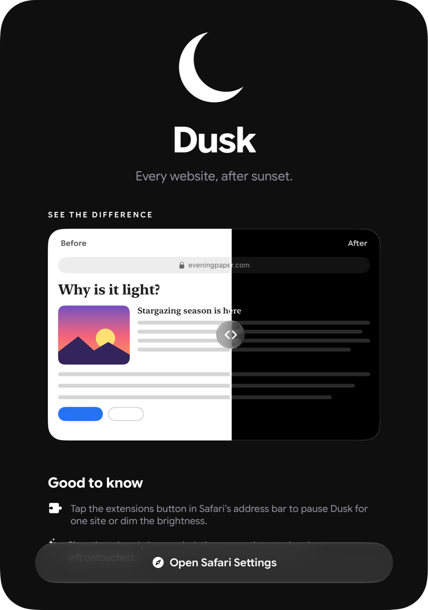

<p align="center">
  
</p>

<h1 align="center">Dusk</h1>

<p align="center"><em>Every website, after sunset.</em></p>

<p align="center">
  A Safari extension for iOS that forces a dark theme on any website,
  paired with a SwiftUI companion app.
</p>

<p align="center">
  
</p>

## Features

- **Dark mode everywhere.** Every page you open in Safari turns dark, including sites that don't offer a dark theme.
- **Photos keep their colors.** Images, video, canvases, and embeds are excluded from the darkening, so pictures look the way they should.
- **Skips sites that are already dark.** Dusk checks the page's real background color and leaves sites that already have a dark theme alone.
- **Per-site control.** From Safari's extensions menu you can pause Dusk on a single site, switch it off everywhere, or turn down the brightness. Changes apply to open tabs instantly.
- **No flash of white.** The dark theme is applied before the page draws, not after it loads.
- **Private by design.** Settings stay on the device, and the extension never sends page content anywhere.

## How it works

The extension runs a content script on every page at `document_start`.

1. **Inversion.** It injects a stylesheet with `filter: invert(1) hue-rotate(180deg)` on the root element. Inverting flips light to dark, and the 180° hue rotation brings colors back to their original hue so a blue link stays blue.
2. **Re-inverting media.** `img`, `video`, `canvas`, `iframe`, and similar elements get the same filter again, which cancels the first one and keeps their true colors.
3. **Detecting native dark themes.** Once the DOM is ready, it reads the computed background color of `<body>` and `<html>`. The CSS filter doesn't affect computed styles, so these are the site's real colors. If the weighted brightness of that color (using the Rec. 709 coefficients) is below 0.4, the page is already dark and the stylesheet is removed.
4. **Staying applied.** A `MutationObserver` re-adds the stylesheet if a single-page app wipes the `<head>`.
5. **Live settings.** The popup writes to `browser.storage.local`, and each tab listens for `storage.onChanged`, so toggles and the brightness slider update open pages without a reload.

The companion app's before/after demo uses the same technique in SwiftUI: `.colorInvert().hueRotation(.degrees(180))` on the page, applied a second time on the photo.

## Tech stack

| Area | Technology |
| --- | --- |
| Companion app | SwiftUI, Liquid Glass (`glassEffect`, `.glass` button style) |
| Extension | Safari Web Extension (Manifest V3), JavaScript, CSS |
| Native bridge | `SafariServices` (`SFSafariSettings` opens the extension settings directly) |
| Typography | Google Sans Flex variable font, scaled with Dynamic Type |
| Icons | Generated with Core Graphics so the app icon and extension icons match |

## Project structure

```
DarkMode/                     SwiftUI companion app
├── DarkModeApp.swift         App entry point
├── ContentView.swift         Main screen and the "Open Safari Settings" action
├── BeforeAfterDemo.swift     Draggable before/after comparison
├── NightSky.swift            App colors and the crescent moon
├── AppFont.swift             Google Sans Flex helpers that respect Dynamic Type
└── Fonts/                    Bundled font and its license

DarkModeExtension/            Safari Web Extension
└── Resources/
    ├── manifest.json         Extension manifest (MV3)
    ├── content.js            Darkening logic that runs on every page
    ├── popup.html/.css/.js   Toolbar popup: on/off, per-site toggle, brightness
    └── images/               Extension and toolbar icons
```

## Getting started

**Requirements:** Xcode 27 or later, and an iPhone or simulator running iOS 27 or later.

1. Clone the repo and open `DarkMode.xcodeproj`.
2. Pick an iPhone simulator or your device, then build and run the **DarkMode** scheme.
3. In the app, tap **Open Safari Settings**, switch on **Dusk**, and set website access to **Allow** for all websites.
4. Open any website in Safari.

To run it on a physical device, set your own development team under **Signing & Capabilities** for both targets.

## Known limitations

Inverting the whole page is fast and works on almost every site, but it has trade-offs:

- Content inside embedded frames, such as comment widgets, keeps its original light colors.
- Images set as CSS `background-image` are inverted. Re-inverting them would also flip any text on top of them.
- A page with a transparent background is treated as white, so it gets darkened.

Fixing these properly would mean rewriting each element's colors individually instead of inverting the page.

## Credits

The [Google Sans Flex](https://fonts.google.com/specimen/Google+Sans+Flex) font is © Google LLC, used under the [SIL Open Font License 1.1](DarkMode/Fonts/GoogleSansFlex-OFL.txt).
